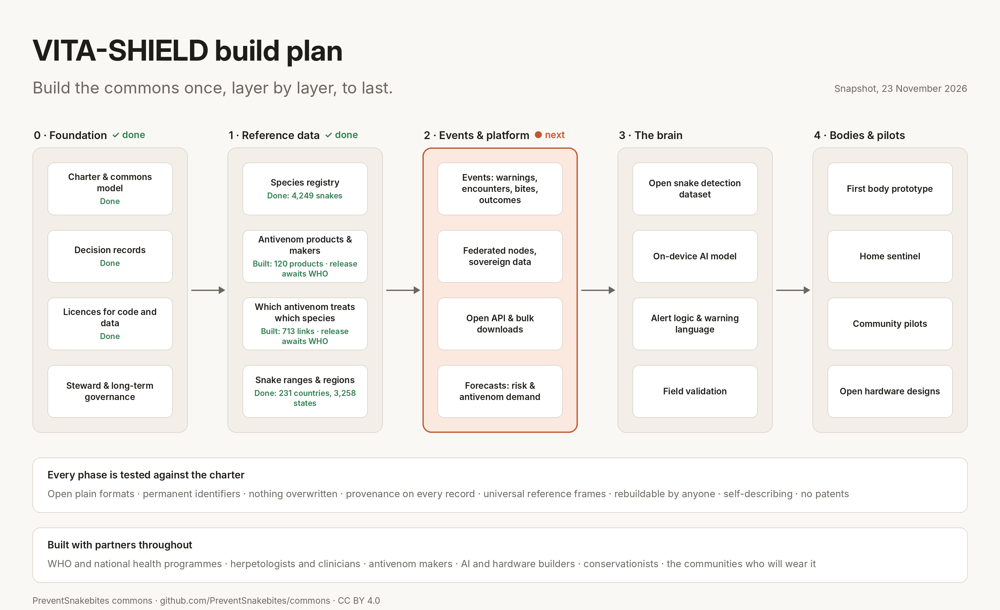

# PreventSnakebites commons

A sovereign digital commons to end snakebite deaths and disabilities, for people and snakes alike. VITA-SHIELD is the prevention system built on it.
Dedicated to humankind and the ecosystem. No patents. Built once, to last.

## Layout

| Folder | Holds |
|---|---|
| `charter/` | Why this exists, who it belongs to, the principles every decision is tested against |
| `decisions/` | One short record per design decision, numbered, never deleted |
| `schema/` | The data model: entities, identifiers, fields, controlled vocabularies |
| `sources/raw/` | Source datasets exactly as received, never edited |
| `data/canonical/` | The commons dataset, built from sources by the scripts in `tools/` |
| `tools/` | Scripts that turn raw sources into canonical data, repeatably |

## Rule of the house

Raw sources are never edited. Canonical data is always rebuilt from them by code, so anyone, at any time, can verify how every record came to be.

## Build plan

Foundation and reference data are done. Next: events and the federated platform.

## Licences

- Code in `tools/`: Apache License 2.0 (`LICENSE`), decision 0007. Its patent grant keeps the code free of patent claims from anyone who contributes.
- Charter, decisions and documentation: Creative Commons Attribution 4.0 (`LICENSE-DOCS`), decision 0007.
- Data: Open Database License 1.0 (`LICENSE-DATA`), decision 0006. Each source keeps its own attribution, listed in `sources/SOURCES.md`.
- WHO antivenom data and the tables built from it are held back from this public repository until WHO confirms its terms.

## Contact

preventsnakebites@csdcgroup.in
